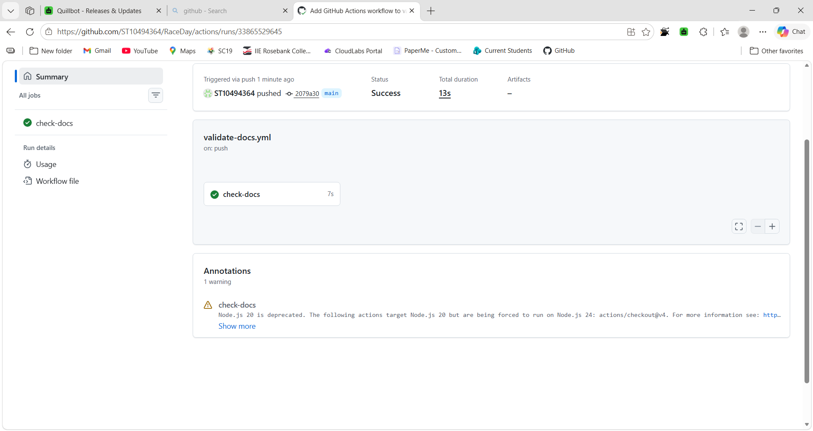
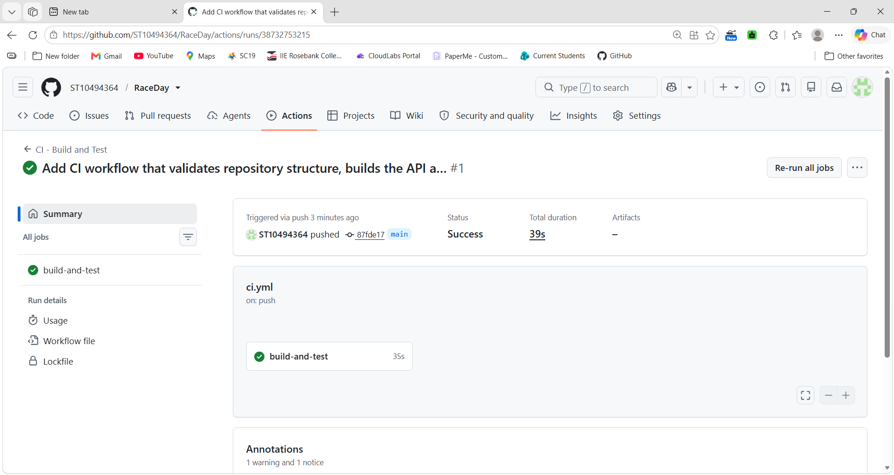

# RaceDay

RaceDay is a full-stack, web-based event management system built for the South African road running, walking, and cycling community. It replaces the paper-based registration and disconnected communication that many local events still rely on, giving Event Organisers a single platform to create and manage events, categories, and results, while Participants can browse events, enrol, and track their own results and history.

This project is an individual Portfolio of Evidence (POE), built progressively across three parts:

- **Part 1 — System Planning and Database**: ERD, API endpoint plan, and SQL database schema. *(complete)*
- **Part 2 — RESTful API**: built in C#, connected to the database, with unit tests and CI/CD. *(current stage)*
- **Part 3 — MVC Web Application**: consumes the API, integrates Azure Blob Storage, and is containerised with Docker.

## Roles

The system supports two distinct user roles:

- **Organiser** — can create, update, and delete events; define event categories; view all enrolments for their events; and capture participant results.
- **Participant** — can browse and view events and categories, enrol in an event under a chosen category, and view their own profile and results.

## Repository Structure

/docs → Planning artifacts and screenshots
- FINAL_ERD.drawio.png — Entity Relationship Diagram
- API_Endpoint_Plan.md — Full API endpoint plan
- RaceDay_Schema.sql — SQL script (schema + seed data)
- ci-success.png — Part 1 CI/CD successful build screenshot
- ci-success-part2.png — Part 2 CI/CD successful build screenshot

 The database design follows a normalised structure: a single `User` table (distinguishing Organisers and Participants via a `role` field) connects to `Event`, which in turn connects to `Category`, `Enrolment`, and `Result` — with `Enrolment` linking Participants, Events, and Categories together. 

/RaceDay.Api → Part 2 ASP.NET Core Web API (controllers, models, DTOs, EF Core migrations)

/RaceDay.Api.Tests → Part 2 xUnit unit tests

/.github/workflows → CI/CD configuration
- validate-docs.yml — Part 1: validates /docs folder structure
- ci.yml — Part 2: validates the repository structure, builds the API and runs all unit tests

## Part 1 — Setup Instructions

Part 1 contains no application code, so there is nothing to run. To review the planning artifacts:

1. Clone this repository or browse it directly on GitHub.
2. Open `/docs/FINAL_ERD.drawio.png` to view the database design.
3. Open `/docs/API_Endpoint_Plan.md` to view the full endpoint plan (renders as a formatted table on GitHub).
4. To run the SQL script yourself:
   - Open `/docs/RaceDay_Schema.sql` in SQL Server Management Studio (SSMS).
   - Run the full script against a SQL Server instance. It will drop and recreate the `RaceDay` database from scratch, create all 6 tables, and seed sample data.

## Part 1 — CI/CD

A GitHub Actions workflow (`.github/workflows/validate-docs.yml`) runs automatically on every push to `main`. It checks that the `/docs` folder exists and contains all three required planning files.

**Latest build status:**

## Part 1 — Video Walkthrough

An unlisted YouTube video walking through the ERD design decisions, the API endpoint plan, and a live run of the SQL script in SSMS:

https://youtu.be/OaIk2n3y3Wo

## Part 2: RESTful API

The API is built with ASP.NET Core 8 (controllers) and Entity Framework Core 8 (code-first migrations) on SQL Server. It implements the endpoint plan from Part 1, with Swagger documentation, session-based authentication, role-based access control and 43 unit tests.

### Part 2: Setup Instructions

**Requirements:** Visual Studio 2022, .NET 8 SDK, and SQL Server (Express or LocalDB) with SSMS.

1. Clone this repository.
2. Open `RaceDay.Api/RaceDay.Api.sln` in Visual Studio. It contains the API project and the test project.
3. Open `RaceDay.Api/appsettings.json` and change the `Server=` part of the `DefaultConnection` connection string to your own SQL Server instance (for example `localhost\\SQLEXPRESS` or `(localdb)\\MSSQLLocalDB`). The database name is `RaceDayApi` and is created automatically. It is separate from the Part 1 `RaceDay` database.
4. Open **Tools > NuGet Package Manager > Package Manager Console**, check the default project is `RaceDay.Api`, and run: `Update-Database`. This creates the six tables, the constraints and the three seeded event types (Run, Walk, Cycle).
5. Press **F5**. Swagger opens in the browser (`/swagger`).
6. To try the API: register one Organiser and one Participant with `POST /api/auth/register`, log in with `POST /api/auth/login` (this starts a session), then call the other endpoints. Logging in as another user replaces the current session.
7. To run the tests: **Test > Run All Tests** in Visual Studio, or `dotnet test RaceDay.Api.Tests/RaceDay.Api.Tests.csproj`.

### Authentication and Roles

- Passwords are hashed with ASP.NET Core's `PasswordHasher` before they are saved. Plain passwords are never stored.
- Login creates a server-side session that stores the user's ID and role (30 minute idle timeout). Every protected endpoint reads the session and returns **401** if nobody is logged in and **403** if the role or ownership is wrong.
- **Organiser:** creates, updates and deletes their own events, defines categories, views enrolments for their own events and captures results.
- **Participant:** enrols in events under a category, and views their own enrolments and results.
- Both roles can view and update their own profile and browse events and categories.

### API Endpoints (16)

| Method | Route | Who can call it |
|---|---|---|
| POST | /api/auth/register | Anyone |
| POST | /api/auth/login | Anyone |
| GET | /api/users/me | Any logged-in user |
| PUT | /api/users/me | Any logged-in user |
| POST | /api/events | Organiser |
| GET | /api/events | Any logged-in user |
| GET | /api/events/{id} | Any logged-in user |
| PUT | /api/events/{id} | Organiser (must own the event) |
| DELETE | /api/events/{id} | Organiser (must own the event) |
| POST | /api/events/{id}/categories | Organiser (must own the event) |
| GET | /api/events/{id}/categories | Any logged-in user |
| POST | /api/events/{id}/enrolments | Participant |
| GET | /api/events/{id}/enrolments | Organiser (must own the event) |
| GET | /api/enrolments/me | Participant |
| POST | /api/events/{id}/results | Organiser (must own the event) |
| GET | /api/results/me | Participant |

### Unit Tests

43 xUnit tests run against an in-memory database. They cover registration and login (including password hashing and wrong credentials), and every other controller, including role and ownership rejection (403), not-logged-in (401), duplicates (409), invalid input (400) and not found (404).

### Part 2 CI/CD

The workflow `.github/workflows/ci.yml` runs on every push to `main`. It validates the repository structure, restores and builds the API, and runs all unit tests.

**Latest build status:**

### Part 2 Video Walkthrough

An unlisted YouTube video walking through the API, authentication and roles, Swagger and the unit tests:

[VIDEO_LINK_HERE](https://youtu.be/GvpZ-HZzEzM)

### Part 2: Deviations from the Part 1 Plan

- **Login:** my Part 1 plan said `/api/auth/login` returns an access token. Part 2 requires session-based authentication, so login now creates a server-side session that stores the user ID and role instead.
- **Added endpoint:** `GET /api/enrolments/me` lets a Participant view their own enrolments. The Roles section of the brief requires this, but it was missing from my Part 1 plan.
- **Endpoint count:** my Part 1 text says 14 endpoints, but the table lists 15. With the added endpoint, the API has 16.
- **Database creation:** the Part 2 database (`RaceDayApi`) is created by EF Core migrations rather than by running the Part 1 SQL script. It has the same six tables, column names, types, keys, unique email, default values and no-cascade foreign keys. The Part 1 sample data is not loaded; only the three event types are seeded.
- **Extra status codes:** the protected endpoints return 401 (not logged in) and 403 (wrong role or not the event's owner), and the create and update endpoints return 400 for invalid input, in addition to the codes in my Part 1 plan.
- **Deleting an event** also deletes its categories, enrolments and results, because the database does not cascade deletes.

## AI Assistance Disclosure

### Part 1

AI assistance (Claude, by Anthropic) was used throughout the planning stage of this project. Specifically, it was used to:

- Explain unfamiliar concepts (e.g. 401 vs 403 HTTP status codes, SQL Server reserved words)
- Talk through and validate design decisions for the ERD (entity choices, relationship cardinality) and the API endpoint plan, based on the functional requirements in the brief
- Help troubleshoot GitHub repository setup, folder structure issues, and the GitHub Actions CI/CD workflow
- Draft an initial version of the SQL script structure, which was then reviewed, tested, and run personally in SSMS against a clean instance to confirm it works correctly

All final design decisions, the analysis of trade-offs (e.g. single User table vs separate Organiser/Participant tables), testing, and verification were done by me. I can explain and defend every choice made in this submission.

### Part 2

AI assistance (Claude, by Anthropic) was used in Part 2 for step-by-step guidance and for help with code, including the model classes, the DbContext, the controllers and the unit tests. I reviewed the code I submitted and I can explain it.

---
© 2026 — PROG6212 Portfolio of Evidence, Parts 1 and 2
